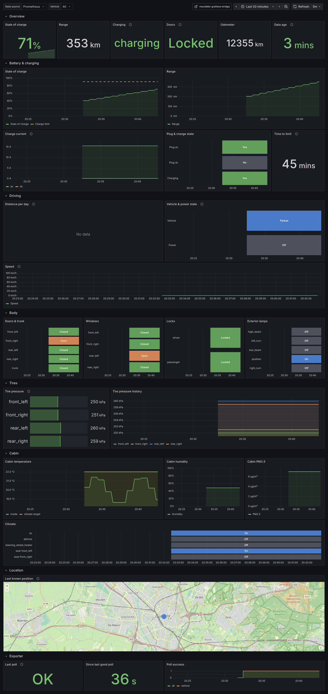
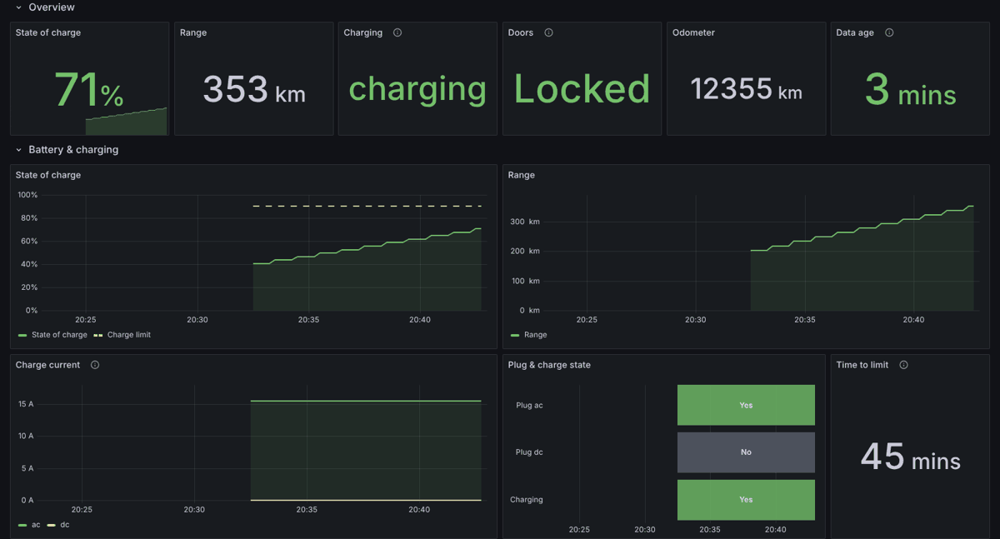
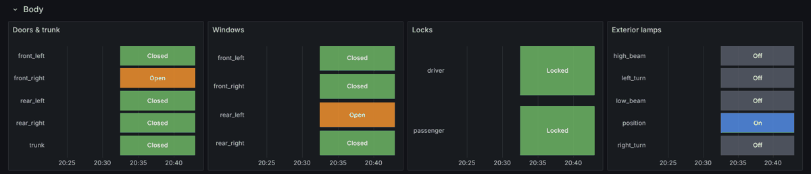
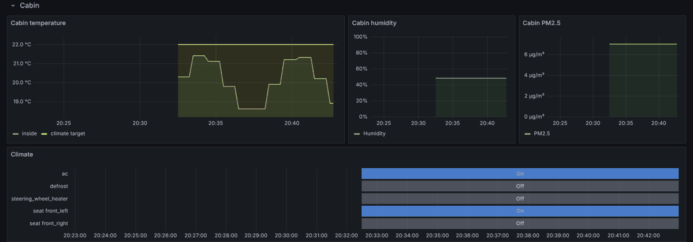

# mazda6e-grafana-bridge

A Prometheus exporter for the **Mazda 6e** cloud API, plus a Grafana dashboard
for it. It logs in with the Mazda app account, polls the car's condition on an
interval and publishes battery, charging, driving, body, cabin and tire state
as Prometheus metrics.

> [!WARNING]
> **The secrets you give it can control your car.** This bridge only reads,
> and CI enforces that (see [Read-only, and how that's enforced](#read-only-and-how-thats-enforced)).
> But `MAZDA_EMAIL` + `MAZDA_PASSWORD` + a verified `MAZDA_DEVICE_ID` together
> are a full login that skips Mazda's email code. Anyone holding all three can
> use other software to start climate control, flash the lights and sound the
> horn, or change the charge limit. Unlocking the doors and opening windows or
> the trunk also needs your six-digit control PIN, which this bridge never asks
> for or stores. Protect the three values like a car key: keep them in an
> encrypted secret (SOPS, Vault, …), never in git, logs or screenshots. If they
> leak, change your Mazda password in the app right away, and the control PIN
> too if it may have leaked. Whether Mazda also ends sessions that are already
> logged in isn't documented, so don't count on it.

> [!IMPORTANT]
> **Unofficial project.** This isn't made, endorsed or supported by Mazda Motor
> Corporation or Changan. **Mazda**, **Mazda 6e** and all related names and
> logos are trademarks of Mazda Motor Corporation. See
> [Disclaimer & trademarks](#disclaimer--trademarks).

<picture>
  <source media="(prefers-color-scheme: light)" srcset="docs/dashboard-light.png">
  
</picture>

- **Read-only, enforced.** It can't lock, unlock, open, climate-control or
  charge-limit the car. The command endpoints aren't in the code, the client
  refuses any endpoint outside a fixed read-only list, and a CI job fails if
  that ever changes.
- **Stateless.** Configuration comes from environment variables only. Tokens
  live in memory. An expired token is refreshed, and a refused refresh falls
  back to a new password login with the same device ID.
- **Fails safe.** A failed poll sets `mazda6e_scrape_success` to `0` instead of
  crashing the process. After a refused login it waits an hour before it tries
  the password again, so a mistake can't lock the account.

The API knowledge (endpoints, headers, credential encryption, field meanings)
comes from [fano0001/home-assistant-mazda-6e](https://github.com/fano0001/home-assistant-mazda-6e),
the Home Assistant integration. See [NOTICE](NOTICE).

## Read-only, and how that's enforced

Read-only rests on three layers. You can check each one yourself in a few
minutes:

1. **No write code.** Only seven endpoints exist in the package: log in, send
   and check the device email code, refresh the token, list vehicles, read the
   vehicle condition. The command routes (`car-control`, `security-code`,
   `serial-no`, …) and the code that signs commands were never ported.
2. **Runtime allowlist.** Every request goes through one function,
   `MazdaClient._post_raw`, which raises `ReadOnlyViolation` for any path not
   in `READ_ONLY_PATHS` ([`api.py`](mazda6e_bridge/api.py)) before anything
   is sent. That error deliberately isn't caught, so the process stops instead
   of carrying on.
3. **CI guard.** The `Read-only guard` job runs
   [`scripts/check_read_only.py`](scripts/check_read_only.py) on every pull
   request and before every release. It fails if:
   - the allowlist differs from the copy pinned in the script;
   - any string in the code looks like an API path that isn't allowlisted;
   - any string or name refers to a command route or field (`car-control`,
     `security-code`, `rcToken`, `control_pin`, …);
   - anything calls `.sign()` or `.decrypt()`, or saves a private key;
   - the HTTP session is used anywhere other than `_post_raw`.

   Tests also prove the guard catches each of these, and that the client
   refuses a door-unlock path without sending anything.

**One caveat, stated plainly.** Mazda's login call requires a public key that
it would use to verify signed commands. The bridge generates a fresh key pair
for each login, sends the public half, and throws the private half away
without ever storing or using it. The bridge's own session therefore can't
sign a command even if code for it were added. Your credentials still can,
from other software; see the warning at the top.

## Metrics

All per-vehicle series carry a `vin` label.

| Metric | Extra labels | Description |
| --- | --- | --- |
| `mazda6e_vehicle_info` | `model`, `name`, `series` | Always `1`. Gives the car's descriptive labels. |
| `mazda6e_battery_soc_percent` | | State of charge in % |
| `mazda6e_range_km` | | Remaining range in km |
| `mazda6e_odometer_km` | | Odometer in km |
| `mazda6e_speed_kmh` | | Speed in km/h, if the car reports it. Implausible values over 250 are dropped. See [Speed](#speed). |
| `mazda6e_vehicle_state` | `state` | One-hot: `driving` / `parked` / `unknown` |
| `mazda6e_power_state` | `state` | One-hot: `off` / `accessory` / `on` / `unknown` |
| `mazda6e_online` | | `1` if the car is connected to the Mazda cloud |
| `mazda6e_status_updated_timestamp_seconds` | | When the car last reported to the cloud |
| `mazda6e_charge_state` | `state` | One-hot: `not_charging` / `charging` / `completed` / `paused` / `unknown` |
| `mazda6e_charging` | | `1` while charging |
| `mazda6e_charge_target_soc_percent` | | Charge limit in % |
| `mazda6e_charge_current_amperes` | `kind` | `total`, `ac`, `dc` |
| `mazda6e_charge_remaining_seconds` | | Time until the limit is reached. Absent when the car has no estimate. |
| `mazda6e_plugged_in` | `connector` | `ac`, `dc` |
| `mazda6e_door_open` | `door` | `front_left`, `front_right`, `rear_left`, `rear_right`, `trunk` |
| `mazda6e_window_open` / `mazda6e_window_open_degree` | `window` | Same positions as doors |
| `mazda6e_unlocked` | `side` | `driver`, `passenger` |
| `mazda6e_lamp_on` | `lamp` | `low_beam`, `high_beam`, `position`, `left_turn`, `right_turn` |
| `mazda6e_tire_pressure_kpa` | `tire` | Same positions as doors, without the trunk |
| `mazda6e_cabin_temperature_celsius` | `sensor` | `inside`, `cockpit` |
| `mazda6e_climate_target_temperature_celsius` | | Remote climate target |
| `mazda6e_cabin_humidity_percent` | | Cabin humidity |
| `mazda6e_cabin_pm25_micrograms_per_cubic_meter` | | Cabin PM2.5 |
| `mazda6e_climate_feature_on` | `feature` | `ac`, `defrost`, `steering_wheel_heater` |
| `mazda6e_seat_mode` / `mazda6e_seat_level` | `seat`, (`mode`) | Seat heating/ventilation |
| `mazda6e_location_latitude_degrees` / `..._longitude_degrees` | | Only with `EXPORT_LOCATION=true`, and only if the car reports a position. See [Location](#location). |
| `mazda6e_scrape_success` | — | `1` if the last poll succeeded |
| `mazda6e_last_success_timestamp_seconds` | — | Time of the last successful poll |
| `mazda6e_vehicle_scrape_success` | | Per-vehicle result of the last poll |
| `mazda6e_vehicles` | — | Vehicles on the account |

The exporter only publishes fields the car actually reports. If a field
disappears, its series is removed, so a missing reading never shows as `0`.

## Configuration

| Variable | Default | Description |
| --- | --- | --- |
| `MAZDA_EMAIL` | _(required)_ | Mazda app account email |
| `MAZDA_PASSWORD` | _(required)_ | Mazda app account password |
| `MAZDA_DEVICE_ID` | _(required)_ | A UUID that identifies this exporter to Mazda. Generate it once and keep it. |
| `POLL_INTERVAL_SECONDS` | `300` | Seconds between polls (minimum 60) |
| `LISTEN_PORT` | `9120` | Port the `/metrics` endpoint listens on |
| `EXPORT_LOCATION` | `false` | Publish the car's GPS position, if it reports one. See [Location](#location). |
| `REQUEST_TIMEOUT_SECONDS` | `30` | Timeout for each HTTP call to Mazda |
| `MAZDA_API_BASE_URL` | Europe backend | Override for testing only |

Only the **Europe** backend is supported. Asian accounts read their status over
MQTT, which this exporter doesn't implement.

### Location

`EXPORT_LOCATION=true` can publish nothing. On the Mazda 6e this was tested
with (Europe backend, 2026-10-13), the vehicle condition reply had no
`location` section at all, although the request asks for one, and no other
field in the reply held a position. The latitude and longitude series then
stay absent and the dashboard's map stays empty. Whether a setting in the car
or the app changes that isn't known.

The field names the exporter reads (`latitude`, `lat`, `gpsLatitude`,
`longitude`, `lng`, `lon`, `gpsLongitude`) are unconfirmed. They come from the
Home Assistant integration, whose code notes that it hasn't seen a position
either. If your car does report one, please open an issue with the shape of
the `location` object: its key names, not your coordinates.

### Speed

On the same Mazda 6e (Europe backend, 2026-10-13 to 2026-10-15),
`mazda6e_speed_kmh` never changed. During a drive of about 33 km the vehicle
state stayed Parked in every poll, while the odometer did count the distance.
The car seems to update its cloud condition mostly while parked, so the
exporter has no live driving data to read. The dashboard therefore has no speed
panel; Distance per day, from the odometer, shows the driving instead. The
metric stays in the exporter in case a car or a firmware update does report
speed.

## Getting started

You need a Mazda app account that already has the car on it, and Docker, or
Python 3.12+ for running from source.

### 1. Pick a device ID and keep it

The device ID tells Mazda which "phone" is signing in. Generate it once and
store it next to your credentials:

```bash
python3 -c 'import uuid; print(uuid.uuid4())'
```

Use this same value everywhere from now on. With a new device ID, Mazda asks
for an email code again, and the exporter stops polling until you redo step 2.

### 2. Verify the device (once)

Mazda emails a six-digit code the first time a device ID signs in. Run
`verify-device` interactively with the same three values the exporter will use:

```bash
export MAZDA_EMAIL='you@example.com'
export MAZDA_PASSWORD='your-mazda-app-password'
export MAZDA_DEVICE_ID='the-uuid-from-step-1'

docker run --rm -it \
  -e MAZDA_EMAIL -e MAZDA_PASSWORD -e MAZDA_DEVICE_ID \
  ghcr.io/yornik/mazda6e-grafana-bridge:latest verify-device
```

It logs in, asks Mazda to send the code, and prompts for it. When you see
`Device verified. Keep MAZDA_DEVICE_ID unchanged from now on.`, you're done.
If it prints `already verified`, nothing needed doing.

To run it from source instead of Docker: `pip install -r requirements.txt`, then
`python -m mazda6e_bridge verify-device`.

### 3. Start the exporter

```bash
docker run -d --name mazda6e-bridge -p 9120:9120 \
  -e MAZDA_EMAIL -e MAZDA_PASSWORD -e MAZDA_DEVICE_ID \
  ghcr.io/yornik/mazda6e-grafana-bridge:latest
```

### 4. Check it works

```bash
docker logs mazda6e-bridge        # expect: "polled 1 of 1 vehicle(s)"
curl -s localhost:9120/metrics | grep -E '^mazda6e_(scrape_success|battery_soc_percent)'
```

`mazda6e_scrape_success 1.0` means the poll worked. If it reads `0.0`, the log
line before it says why:

| Log says | Fix |
| --- | --- |
| `this MAZDA_DEVICE_ID is not verified yet` | Run step 2 with the same device ID. |
| `login refused (code …)` | Wrong email or password. After fixing it, restart the container so it doesn't wait out the hour-long backoff. |
| `failed to list vehicles: … HTTP 5xx` or a connection error | Mazda's cloud is having trouble. The exporter retries on the next poll. |

### 5. Scrape it and import the dashboard

Point Prometheus at `:9120/metrics`. A 5-minute poll interval means a 30–60 s
scrape interval is plenty. Then import the dashboard; see
[Grafana dashboard](#grafana-dashboard).

## Grafana dashboard

[`dashboards/mazda6e.json`](dashboards/mazda6e.json) has these sections:

- **Overview:** state of charge, range, charge state, locks, odometer and data age.
- **Battery & charging:** SoC against the charge limit, range, AC/DC current,
  plug/charge timeline and time to limit.
- **Driving:** distance per day, vehicle and power state. There is no speed panel; see [Speed](#speed).
- **Body:** door, trunk, window, lock and lamp timelines.
- **Tires:** current pressures and history.
- **Cabin:** temperatures, humidity, PM2.5, climate and seat timelines.
- **Location:** last known position. Needs `EXPORT_LOCATION=true` and a car
  that reports a position; see [Location](#location).
- **Exporter:** poll health.

Battery and charging at a glance:



Doors, windows, locks and lamps as state timelines:



Cabin climate:



All screenshots use test data from a fake Mazda API, not a real car.

To import it, go to **Dashboards → New → Import**, upload the file and pick
your Prometheus data source. To provision it with the kube-prometheus-stack
Grafana sidecar, wrap the file in a `ConfigMap` labelled `grafana_dashboard: "1"`.

## Kubernetes

The image runs as uid 65532 with a read-only root filesystem and needs no
volume. Run it like `dirigera-exporter`: a Deployment, a Service and a
ServiceMonitor in the GitOps repo, with the three values in a SOPS-encrypted
Secret.

**1. Create the Secret.** Name the keys after the environment variables, so
the Deployment can load them all with `envFrom`:

```yaml
# mazda6e-api-secret.enc.yaml (encrypt before committing)
apiVersion: v1
kind: Secret
metadata:
  name: mazda6e-api
  namespace: monitoring
type: Opaque
stringData:
  MAZDA_EMAIL: you@example.com
  MAZDA_PASSWORD: your-mazda-app-password
  MAZDA_DEVICE_ID: the-uuid-from-step-1
```

```bash
sops --encrypt --in-place mazda6e-api-secret.enc.yaml
```

**2. Load it in the Deployment:**

```yaml
containers:
  - name: mazda6e-bridge
    image: ghcr.io/yornik/mazda6e-grafana-bridge:v1.0.0
    envFrom:
      - secretRef:
          name: mazda6e-api
    ports:
      - name: http
        containerPort: 9120
```

**3. Verify the device from inside the cluster.** Do this once, after the
Secret exists and before relying on the exporter:

```bash
kubectl -n monitoring run mazda6e-verify --rm -it --restart=Never \
  --image=ghcr.io/yornik/mazda6e-grafana-bridge:v1.0.0 \
  --overrides='{"spec":{"containers":[{"name":"mazda6e-verify",
    "image":"ghcr.io/yornik/mazda6e-grafana-bridge:v1.0.0",
    "args":["verify-device"],"stdin":true,"tty":true,
    "envFrom":[{"secretRef":{"name":"mazda6e-api"}}]}]}}'
```

If the exporter pod started before you verified, restart it with
`kubectl -n monitoring rollout restart deploy/mazda6e-bridge`, so it doesn't
wait out the hour-long login backoff.

## Development

```bash
python -m venv .venv && . .venv/bin/activate
pip install -r requirements-dev.txt
ruff check . && ruff format --check . && pytest
```

The tests mock the Mazda API and need no account or car.

### CI

[`checks.yaml`](.github/workflows/checks.yaml) holds every check. It runs on
pull requests and on `main`, and again on the release commit before an image
is published:

| Job | What it checks |
| --- | --- |
| Lint | `ruff check`, `ruff format`, `actionlint`, `hadolint` |
| Read-only guard | No write endpoint, command field, signing call or allowlist change in the package. See [Read-only, and how that's enforced](#read-only-and-how-thats-enforced). |
| Test | `pytest` with coverage in the run summary. The tests also check that every metric the dashboard queries is exported. |
| Dashboard | Runs every dashboard query through `promtool`, the Prometheus parser |
| Audit | `pip-audit` over the runtime dependencies |
| Image | Builds the image, then runs it read-only as non-root against an unreachable API and checks that it serves `/metrics` and reports the failed poll |

Releases are cut by release-please from Conventional Commits and pushed to
`ghcr.io/yornik/mazda6e-grafana-bridge` with an SBOM and provenance. Every
action is pinned to a commit digest. Renovate keeps the digests and tool
versions current, with a three-day minimum release age.

## Security

See [SECURITY.md](SECURITY.md). In short:

- **A problem in this project**, such as a read-only bypass or leaked
  credentials: report it privately via **Security → Report a vulnerability**,
  never in a public issue.
- **A problem in Mazda's or Changan's systems**, such as the cloud API, the app
  or the car: don't publish it, here or anywhere. Mazda has no published
  disclosure channel, so SECURITY.md lists coordinators (JPCERT/CC, EU
  national CSIRTs, CERT/CC) that get reports to the right team.

## Disclaimer & trademarks

**This is an independent, unofficial project.** It is not made, endorsed,
sponsored, authorized or supported by Mazda Motor Corporation, its
subsidiaries or national distributors, or by Changan Automobile, which runs the
backend the app talks to. None of them has any affiliation with it.

**Trademarks.** **Mazda**, **Mazda 6e**, **MyMazda**, the Mazda logo and all
related names, marks and logos are trademarks or registered trademarks of Mazda
Motor Corporation. They are used here only to identify the vehicle this
software works with (nominative use). That use doesn't imply any affiliation
with or endorsement by Mazda. This project doesn't use the Mazda logo.

**No support.** Mazda doesn't support this software. Don't contact Mazda,
your dealer or Mazda customer service about it; open an issue in this
repository instead. Using it doesn't change what Mazda supports for your car
or account.

**Use at your own risk.** The exporter only reads data, but it uses your own
account against the same undocumented cloud API as the official app. Mazda can
change, rate-limit or block that API at any time, and could in principle act
on accounts that use it. The software comes without any warranty. See
[LICENSE](LICENSE).

## License

[Apache-2.0](LICENSE). This repo contains code adapted from an Apache-2.0
project. See [NOTICE](NOTICE).
